# ECHOS: Evidence-Centred Health Observation and Support through Collaborative AI Agents

Multi-agent decision support for home-dwelling elderly patients. **Not a diagnostic tool.** Results and caveats: [reports/RESULTS.md](reports/RESULTS.md); limits: [docs/LIMITATIONS.md](docs/LIMITATIONS.md); design: [docs/ARCHITECTURE.md](docs/ARCHITECTURE.md); 5-minute demo: [docs/DEMO.md](docs/DEMO.md); connecting a device: [docs/INGESTION.md](docs/INGESTION.md).

**Acknowledgement:** TIHM data courtesy of the Surrey and Borders Partnership NHS Foundation Trust (Palermo et al., *Scientific Data* 2023, doi 10.1038/s41597-023-02519-y; research and patient-benefit use only, no commercial use; see [docs/DATA_STATEMENT.md](docs/DATA_STATEMENT.md)). SisFall (Sucerquia et al., *Sensors* 2017) is used for the fall model.

## Overview

ECHOS watches the room sensors, vital signs and accelerometer data of one older person living at home and tells their caregiver and clinician **at once** about a fall or a critical reading, and **every day** about anything that differs from that person's own usual, with the evidence. It is decision support, not diagnosis: the language model only words reports and never decides an emergency; plain rules do.

- **Detectors sense, never decide:** a rule-based **Data Quality gate**; the **Vitals + Behaviour detector** (XGBoost with SHAP, personal past-only baselines, persistence; drift/CUSUM explains only); the **Fall detector** (SisFall only, independent of the others).
- **Agents act and leave a trace:** **Triage** (plain if-then rules: Normal / Changed-monitor / Urgent), the **Case Investigator** (bounded tool loop, writes the case file), the **Care Coordinator** (owns the alert until someone acts: acknowledgement, escalation to a second contact, check-in and review tasks) and the **Report agent** (LLM wording behind a non-LLM validator, template fallback). They hand work to each other over a SQLite message bus; the **Agent activity** page shows it live.
- **Alerts** for falls and critical vitals go out first, as a fixed template with no LLM, with retries and dedup; the e-mail can carry a signed "I have seen this" link. Mail is a dry run unless you switch it on.
- **Three data modes, always labelled:** REPLAY (TIHM day by day, for evaluation), EMULATOR (labelled device emulator, real TIHM events in real time) and LIVE (real devices through `POST /api/ingest/events`, see [docs/INGESTION.md](docs/INGESTION.md)).
- There is no trained fusion model. Small cohort (about 49 labelled patients), simulated falls and no real device yet: see [docs/LIMITATIONS.md](docs/LIMITATIONS.md) before drawing conclusions.

### Quick start

```bash
scripts/start.sh --live --fresh     # API + watchdog + runtime + web app; prints the URLs; Ctrl-C stops all. Dry-run mail, no LLM, no PubMed.
scripts/start.sh --replay           # the TIHM study replayed day by day (needs data/echos.db, see Reproduce)
```

Open the printed web address. In *Demo tools* press **Start** (emulator) or **Play** (replay), then watch **Today**, **Alerts** and **Agent activity**. A 5-minute walk-through is in [docs/DEMO.md](docs/DEMO.md); screenshots of every page are in [web/screenshots/](web/screenshots/).

| Component | What it does | Data |
|---|---|---|
| Data Quality agent | Rules only: range checks, duplicates/order, activity sensor-gap detection, completeness; never imputes. [docs/DATA_POLICY.md](docs/DATA_POLICY.md) | TIHM Activity + Physiology |
| Health Monitoring agent: vitals sub-model | XGBoost on blood pressure / heart rate against the person's own past-only baseline; direction-aware findings (BP high / low, heart rate high / low, temperature, weight) | TIHM Physiology + Labels |
| Health Monitoring agent: behaviour sub-model | Agitation classifier (only `agitation_prob` can trigger Monitor); routine drift / CUSUM as explanation only | TIHM Activity |
| Fall agent | Random forest on 2.5 s accelerometer windows + post-fall inactivity | SisFall only (TIHM has no falls) |
| Orchestrator | sequential pipeline with per-step SQLite progress, deterministic triage and safety rules | agent outputs |
| Alert dispatcher | Fixed-template e-mail to caregiver and clinician, retrying outbox, no LLM | structured data only |
| Report agent | Daily (tool loop, per-finding gated retrieval, validator, template fallback) and weekly PDF | agent outputs in SQLite |

```mermaid
flowchart LR
    SIM["Simulator<br/>TIHM replay + injected SisFall falls<br/>(synthetic: tests and demos only)"] --> EL[(SQLite event_log)]
    EL --> DQ["Data Quality agent<br/>(rules)"]
    EL --> FALL["Fall agent<br/>(SisFall-trained, independent)"]
    DQ -->|cleaned patient-day| HM["Health Monitoring agent<br/>vitals sub-model + behaviour sub-model<br/>(kept separate; SHAP, personal baseline, persistence)"]
    DQ --> AO[(agent_output)]
    HM --> AO
    FALL --> AO
    AO --> ORCH["Orchestrator pipeline (resumable)<br/>deterministic triage: Normal / Changed-monitor / Urgent<br/>safety rules: DATA_GAP never Normal, critical vitals, fall"]
    ORCH -->|immediate_alert node, BEFORE any report work| OB[(outbox)]
    OB --> DISP["Alert dispatcher<br/>retrying outbox, worker threads,<br/>2 h sweeper, dedup, fixed template, no LLM"]
    DISP --> MAIL["Caregiver + clinician e-mail<br/>(dry run by default)"]
    ORCH --> REP["Report agent<br/>context in prompt; tools: get_last_7_days, retrieve_guidance<br/>NORMAL days = template (gate)"]
    REP -->|MONITOR / URGENT findings only| RAG["Per-finding gated RAG<br/>local guideline index, then live PubMed"]
    RAG --> REP
    REP --> BUD["LLM budget manager<br/>cache, primary, fallback model, template"]
    BUD --> VAL["Non-LLM validator<br/>numbers, citation ids, no diagnosis / medication advice"]
    VAL -->|rejected, timeout, no key| TPL["Template report"]
    VAL -->|ok| OUT["Daily report (web app)<br/>Weekly clinician PDF (e-mail)"]
    TPL --> OUT
    OUT --> API["FastAPI<br/>reads SQLite + saved reports, no models"]
    API --> WEB["React web app"]
    SUP["Supervisor<br/>heartbeats, restarts"] -.-> DQ
    SUP -.-> HM
    SUP -.-> FALL
```



## Research gaps and what we measured

Written by `scripts/docgen/make_research_gaps.py` from `reports/metrics/*.json`.

<!-- research_gaps:start -->
| Gap | Mechanism | Measured evidence (95% CI) | Caveat |
|---|---|---|---|
| Raw alerts without context or explanation | Every vitals and fall alert is shown with its values against the person's own usual, a plain-words 'why it fired' line, SHAP top features and persistence evidence (drift/CUSUM explanation-only); the daily and weekly reports cite guideline sources per finding. | Alert burden with context attached: MONITOR days 28.8%, URGENT 4.5% of 1266 replayed patient-days; vitals sub-model at 1 alert/patient-week: recall 0.72 (0.63-0.81) vs chance 0.23. Automated text proxy (not a reader study) on 112 template daily reports: median reading grade 5.43, median length 34 words, all checks passed in 112/112 (grade <= 10, <= 220 words, named next steps, no banned wording). | Whether the explanations are clear or useful to a reader has NOT been measured (rating kit prepared in reports/rating, not run); the text proxy checks wording rules of simple template text, not understanding, and says nothing about LLM wording. Replay, not live use. |
| Fixed thresholds ignore the individual | Past-only personal baselines (shift(1)); XGBoost on deviation from the person's own usual, not on absolute values alone. | Vitals PR-AUC 0.697 (0.571-0.782) vs fixed BP rule 0.261 (0.183-0.346); at the rule's own alert count recall 0.90 (0.83-0.94) vs 0.76 (0.61-0.88) (out-of-fold, patient-level folds, patient bootstrap CI; the recall CIs overlap). | Labels are described as clinician-verified events but we did not verify how they were produced, and 99% of BP-label days have a BP reading, so vitals results are an upper bound on generalisation; 54 patients; agitation score is modest (PR-AUC 0.22 vs base rate 0.05) and ranks within patients, it is not a probability. |
| Fragile pipelines and silent sensor failure | Rule-based Data Quality agent (ranges, gaps, completeness; never imputes); a day with a sensor gap / unchecked data / >7 days without vitals is DATA_GAP and never Normal; supervisor restarts dead workers; documented fallbacks. | 132 of 2797 patient-days (4.7%) flagged as sensor gap; replay data-gap days 4.5%, 0 flag mismatches. Fault injection: 11 of 11 fault cases (worker / supervisor / API kills, LLM and PubMed failures, SMTP failures) lost no alert and made no duplicate; exception: SMTP down for 8 s (longer than the 3-attempt retry window): 10 outbox rows FAILED (undelivered, visible; measured before the 15-minute retry window and 2-hour sweeper existed). | 3 patients x 10 days, one fault per case, fakes for LLM / SMTP / PubMed, one machine; the supervisor is a single point of failure for restarts. |
| Unsafe LLM text | The LLM never decides emergencies and is not on the alert path; reports pass a non-LLM validator (numbers from the data, cited ids, no diagnosis / medication advice); NORMAL days use a template with no LLM; any failure falls back to the template. | Gate: 845 of 1266 days (66.7%) need no LLM; triage identical with the gate on and off: True; alerts missed due to gating: 0. LLM errors and timeouts (fake): reports fell back to the template, no alert lost. | Quality of real model output was NOT evaluated (only fakes in tests; the live check is recorded separately). The validator catches the rules it encodes, not every unsafe sentence. |
| Alert delivery and delays | Fall and critical-vitals alerts are queued before any report work as a fixed template (no LLM); outbox with retries (backoff, 15-minute window, 2-hour sweeper); dedup per event. | Software latency, event to queued median 1.3 ms, to sent (fake mailer) median 31 ms (p95 33 ms); under 4 busy threads median 0.46 s (p95 1.08 s). Injected falls raised an URGENT alert in 51/60 = 0.850 (0.739-0.919); false fall alerts 0.011 per patient-week. | Replay delay (median 13.1 h, max 23.8 h) is a daily-batch artefact; the live path is sub-second. Real SMTP was never exercised; falls are simulated SisFall windows; 4 held-out subjects. |

**Not claimed:** clinical validity (nothing here was validated against clinical outcomes or in a clinical setting); deterioration forecasting (the models detect same-day clinical-alert labels, they do not predict future events); algorithmic novelty (standard XGBoost / random forest / rules on personal baselines; the contribution is the safety-oriented system around them). Decision support, not diagnosis.
<!-- research_gaps:end -->

## Reproduce

Python 3.11 (see `.python-version`) and Node 20+ for the web app. Data, models and indexes are git-ignored: you rebuild them as below. All commands from the repo root; **no step needs Gemini, PubMed or e-mail** (the evaluation scripts force them off).

```bash
# 1. environment
python3.11 -m venv .venv && source .venv/bin/activate
pip install -r requirements.txt            # exact versions; direct dependencies are listed in requirements.in
cp .env.example .env                       # optional: only for the real-service scripts (names only in the example)
```

```bash
# 2. obtain the data (not in the repository; check each dataset's licence)
#    TIHM (UK DRI Care Research & Technology Centre, Technology Integrated Health Management): download the dataset, then place
#      Activity.csv, Physiology.csv, Labels.csv, Demographics.csv (Sleep.csv is not used) in   data/tihm/Dataset/
#    SisFall (Universidad de Antioquia; Sucerquia et al., Sensors 2017): unzip so that the subject folders SA01..SE15 are in   data/sisfall/SisFall_dataset/
#    Guideline PDFs: the five documents in echos/knowledge/SOURCES.md, saved under the listed file names in   echos/knowledge/raw/
mkdir -p data/tihm/Dataset data/sisfall            # then copy the files in
ls data/tihm/Dataset data/sisfall/SisFall_dataset echos/knowledge/raw
```

```bash
# 3. build tables and train every model (offline; takes several minutes; writes data/processed/, models/, reports/metrics/*.json)
scripts/rebuild_models.sh
# 4. ingest the guideline index (the first run downloads the all-MiniLM-L6-v2 embedding model once; after that it is local)
PYTHONPATH=. python -m echos.knowledge.ingest
# 5. demo database: replay -> agents -> orchestrator -> reports into data/echos.db (template mode, dry-run mail, ~3 min)
PYTHONPATH=. python scripts/demo/run_demo.py 4 28
```

One command (API + watchdog + runtime + web app, dry-run mail, no LLM, no PubMed; prints only URLs; Ctrl-C stops everything): `scripts/start.sh --live` or `scripts/start.sh --replay` (add `--auth`, `--fresh`; `--llm` / `--pubmed` only if you want those real services). Logs in `data/logs/`.

```bash
# 6a. LIVE / EMULATOR mode (the main way to run it): raw events -> ingestion API -> detectors scored from events -> rolling triage, with the labelled device emulator
rm -f data/echos_live_dev.db data/echos_live_dev.db-wal data/echos_live_dev.db-shm
scripts/run_api.sh --dry --no-llm --demo --mode live --db data/echos_live_dev.db     # API on http://127.0.0.1:8000, docs at /docs; add --no-emulator for real sources only
cd web && npm ci && npm run dev                                                      # UI on http://localhost:5173: Demo tools -> Start
# 6b. REPLAY mode (evaluation: the TIHM study day by day; a copy of the database, so the UI never touches data/echos.db)
scripts/make_ui_dev_copy.sh
scripts/run_api.sh --dry --no-llm --demo --db data/echos_ui_dev.db
```

```bash
# 7. tests (each Python test file in its own process; tests never use the real LLM, PubMed or SMTP)
for f in tests/test_*.py; do python -m pytest "$f" -q; done
cd web && npx playwright test && npx playwright test -c playwright.live.config.ts && node contrast.mjs && npx tsc -b && npm run build
python scripts/docgen/check_docs_numbers.py
```

Tests that need the data or the built tables are reported as **skipped** (with the reason) in a clone that does not have them yet.

### Evaluations (optional; all forced offline by `echos/offline.py`)
```bash
PYTHONPATH=. python scripts/evaluation/e2e.py 20              # 20 patients, full period -> reports/metrics/e2e.json
PYTHONPATH=. python scripts/evaluation/fault_injection.py     # fakes only: kill workers / supervisor, LLM, PubMed, SMTP, API faults
PYTHONPATH=. python scripts/evaluation/fall_eval.py           # per-fall-type sensitivity, injected falls, inactivity effect
PYTHONPATH=. python scripts/evaluation/ablation.py            # fixed rules / vitals only / full system, out-of-fold, patient bootstrap CIs
PYTHONPATH=. python scripts/evaluation/gate_eval.py           # report gate: LLM / retrieval calls avoided, triage identical on/off
PYTHONPATH=. python scripts/demo/monitor_driver.py      # MONITOR share driver + threshold proposal (not applied)
PYTHONPATH=. python scripts/evaluation/threshold_holdout.py   # do the MONITOR thresholds generalise to held-out patients? (offline)
PYTHONPATH=. python scripts/evaluation/live_parity.py         # scoring from raw events == scoring from the pre-built table (offline)
PYTHONPATH=. python scripts/evaluation/evaluate.py            # merge metrics into reports/results_table.md/.csv
PYTHONPATH=. python scripts/docgen/make_research_gaps.py  # regenerate the research-gaps table above
```
Rating study kit (reader-rated clarity, usefulness and safe wording; nothing is sent anywhere): `PYTHONPATH=. python scripts/docgen/make_rating_sheet.py` builds 10 shuffled items from the demo database into `reports/rating/` (git-ignored); raters save filled copies of `rating_sheet.csv` in `reports/rating/filled/`; `PYTHONPATH=. python scripts/docgen/analyse_ratings.py` prints per-item and overall means, SDs and rater agreement.
Real-service scripts (`scripts/realservices/list_models.py`, `scripts/realservices/live_llm_check.py`, `scripts/realservices/live_report_check.py`, `scripts/send_test_*.py`) refuse to run without `--yes` and are never used by tests or demos.

## Report agent: LLM, RAG, privacy

- **LLM:** Google Gemini via `google-genai`; model names in `config.yaml` (`llm.model`, `llm.fallback_model`). Requests go through the budget manager (cache, primary, fallback, template); a 429 is a 60 s cooldown, timeouts are never retried. No model or no key means template mode.
- **RAG:** guideline PDFs (CDC STEADI, NICE NG249 falls, NICE NG97 dementia, NICE NG136 hypertension, RCP NEWS2) are chunked (~250 words, 50 overlap), embedded locally with `all-MiniLM-L6-v2` and stored in Chroma (`data/rag/`). Retrieval is per finding and only on MONITOR / URGENT days: local index first, then live PubMed; vitals findings are direction-aware and a source that does not match its finding is dropped. The LLM may only paraphrase retrieved sources and must cite their ids; the validator rejects uncited statements, unknown ids and diagnostic wording. NORMAL days use a template with no LLM and no retrieval.
- **Privacy:** the LLM receives only structured summaries (pseudonymous patient id, day, flags, statistics, evidence ids) plus public guideline text, never raw sensor rows. Alert e-mails carry a de-identified id and age band. The API masks addresses and never returns secrets.

## API and web app

`scripts/run_api.sh [--dry] [--no-llm] [--demo] [--no-runtime] [--db PATH]`: the API is bound to 127.0.0.1, CORS allows `http://localhost:5173` only, and there is **no authentication** (local demo). `--dry` forces dry-run mail, `--no-llm` also switches live PubMed off, `--demo` enables agent kill and the Demo guide. Endpoints: [docs/API.md](docs/API.md).

Pages: Today (who needs action now, changes from their usual, data to check, tasks, data freshness, what the agents are doing), Alerts (lifecycle, acknowledge, delivery log, tasks), People (per patient: why flagged, the Case Investigator's case file with its trace, vitals / routine), Fall Monitor, Caregiver report (today's report, 7-day strip, how it was made), Clinician week (weekly report, references, PDF, send, outbox), Agent activity (every detector / agent / infrastructure part with its status and latest action, a step-by-step view of one case from detector to report, and a filterable activity timeline), How it works (detectors, agents, message bus, live status), System (health, data quality, models, limitations), a mode badge (REPLAY / EMULATOR / LIVE) on every page, and *Demo tools* (data-source controls; the replay Demo guide only in replay mode). `cd web && npm run gen:api` regenerates the typed API client; `npx playwright test` starts its own throw-away stack (API :8010, Vite :5180, database copy `data/echos_e2e.db`); `npx playwright test -c playwright.live.config.ts` runs the live-mode story (API :8021, Vite :5191, fresh database `data/echos_e2e_live.db`).

## Headline results (see [reports/RESULTS.md](reports/RESULTS.md) for CIs and caveats)

- Vitals sub-model PR-AUC 0.70 vs 0.26 for the fixed BP rule (out-of-fold, patient-level folds).
- Behaviour sub-model (agitation) PR-AUC 0.22 vs 0.05 base rate, median within-patient ROC-AUC 0.82; it ranks days within a patient but is not a reliable probability and is never shown as one. Drift alone is at chance and is report evidence only.
- Fall agent sensitivity 0.918 adults / 0.560 elderly (one subject), on SisFall scripted falls, at the chosen operating point (score >= 0.8 and post-fall inactivity).
- End-to-end (20 patients, 60 injected falls): 51 detected (85%); days are 67% Normal / 29% Monitor / 4% Urgent (Wilson 95% CI for detection 0.739-0.919; the earlier, less strict operating point detected 57/60, see [docs/LIMITATIONS.md](docs/LIMITATIONS.md)).
- Fault injection (fakes, 3 patients x 10 days): no alert lost and no duplicate in 11 of 11 fault cases; the SMTP outage case, measured before the retry window was added, leaves undelivered rows FAILED instead.

Small cohort, clinical-alert labels, simulated falls: treat all numbers as preliminary.
