# ECHOS: Evidence-Centred Health Observation and Support through Collaborative AI Agents

Multi-agent decision support for home-dwelling elderly patients. **Not a diagnostic tool.** Results, tables and limitations are in [reports/RESULTS.md](reports/RESULTS.md).

## Overview

A simulator replays TIHM activity and physiology day by day and injects SisFall fall windows. Agent 0 (rule-based data quality) cleans each patient-day, then three analysis agents score it; a LangGraph orchestrator applies plain if-then triage (Normal / Monitor / Urgent, no trained fusion model) and a Report agent writes a daily caregiver report and a weekly clinician report. A supervisor watches SQLite heartbeats and restarts dead or stalled agents.

| Agent | What it does | Data |
|---|---|---|
| 0 Data quality | Rules only: range checks, duplicates/order, activity sensor-gap detection, completeness; never imputes. See [docs/DATA_POLICY.md](docs/DATA_POLICY.md) | TIHM Activity + Physiology |
| 1 Physiological | XGBoost on BP / heart-rate vs personal past-only baseline | TIHM Physiology + Labels |
| 2 Behaviour | Routine drift (z-score, CUSUM) + agitation classifier | TIHM Activity |
| 3 Fall | Random-forest on 2.5 s accelerometer windows + post-fall inactivity | SisFall only (TIHM has no falls) |
| 4 Report | Daily and weekly reports; guideline retrieval (RAG), optional Gemini wording, non-LLM validator, Jinja2 template fallback | agent outputs in SQLite |

Architecture details: [docs/ARCHITECTURE.md](docs/ARCHITECTURE.md). Every agent returns the `AgentResult` schema ([echos/schemas.py](echos/schemas.py)). The LLM never decides emergencies; rules do. With no key or no `llm.model`, reports run in template mode.

```mermaid
flowchart LR
    SIM["Simulator<br/>TIHM replay + SisFall falls"] --> EL[(SQLite event_log)]
    EL --> A0["Agent 0<br/>Data quality (rules)"]
    EL --> A3["Agent 3<br/>Fall"]
    A0 -->|cleaned patient-day| A1["Agent 1<br/>Physiological"]
    A0 --> A2["Agent 2<br/>Behaviour"]
    A0 --> AO
    A1 --> AO[(agent_output)]
    A2 --> AO
    A3 --> AO
    AO --> ORCH["LangGraph orchestrator<br/>rule-based triage, SQLite checkpoints<br/>DATA_GAP rule"]
    ORCH -->|URGENT: fall / critical vitals| AL[(alerts + outbox)] --> MAIL[background mailer: caregiver + clinician, fixed template, no LLM]
    ORCH --> A4["Agent 4 Report<br/>template + optional LLM + validator"]
    AL --> A4
    KB[("Guideline PDFs<br/>echos/knowledge/raw")] -->|ingest: clean, chunk, MiniLM embed| VS[("Chroma<br/>data/rag")]
    A4 -->|get_guideline: finding -> query| VS
    VS -->|top-k chunks KB-n| A4
    A4 -->|structured summary + KB chunks only| LLM["Gemini (optional)"]
    LLM -->|JSON: wording + cites| VAL["Validator (non-LLM)<br/>evidence ids, KB ids, paraphrase, no diagnosis"]
    VAL -->|ok| OUT
    VAL -->|rejected / timeout / no key| TPL["Jinja2 template fallback"]
    TPL --> OUT["Daily caregiver / weekly clinician report"]
    OUT --> DASH["React web app"]
    SUP["Supervisor<br/>heartbeats, restart"] -.monitors.-> A0
    SUP -.-> A1
    SUP -.-> A2
    SUP -.-> A3
```



## Setup

```bash
pip install -r requirements.txt
```

Place TIHM CSVs in `data/tihm/Dataset/` and SisFall in `data/sisfall/SisFall_dataset/` (data and models are git-ignored). Settings are in [config.yaml](config.yaml). Optional LLM: set `llm.model` in `config.yaml` and put `ECHOS_LLM_API_KEY` in `.env`.

## Report agent: LLM, RAG, privacy

- **LLM:** Google Gemini via `google-genai`; `config.yaml` currently has `llm.model: gemini-3.5-flash-lite`, temperature 0.2, timeout 45 s (never retried), 1 retry for other failures, 8 requests/min, backlog 200. No model or no key means template mode.
- **RAG (`rag.enabled`, default true):** guideline PDFs in `echos/knowledge/raw/` (CDC STEADI, NICE NG249 falls, NICE NG97 dementia, NICE NG136 hypertension, RCP NEWS2) are cleaned, split into ~250-word chunks (50-word overlap), embedded locally with `all-MiniLM-L6-v2` and stored in Chroma (`data/rag/`, git-ignored). Build with `PYTHONPATH=. python3 -m echos.knowledge.ingest`; check relevance with `scripts/rag_check.py`. The retriever (`get_guideline`) maps a finding type to a query and returns the top `k=3` chunks (cosine >= 0.25) with ids like `[KB-3]`. The LLM may only paraphrase them and must cite ids; the validator rejects uncited statements, unknown ids, near-verbatim copying and diagnostic wording. The template fallback and the weekly "References (for clinician review)" list the cited sources. `rag.enabled: false` removes guidance; reports still work.
- **Privacy:** the LLM receives only structured summaries (pseudonymous patient id, day, flags, statistics and evidence ids, plus retrieved public guideline text), never raw sensor rows, and never decides emergencies; alerts are written before any LLM call. Embeddings are computed locally. The API key is read from `.env` and never logged.

## Run each stage

All commands from the repo root.

```bash
# 1. patient-day table
PYTHONPATH=. python3 -m echos.data.patient_day
# 2. train + evaluate agents (writes models/ and reports/metrics/agent{1,2,3}.json)
PYTHONPATH=. python3 -m echos.agents.health.vitals
PYTHONPATH=. python3 -m echos.agents.health.behaviour
PYTHONPATH=. python3 -m echos.agents.fall
# 3. fall window audit + operating point -> config.yaml (agent3.operating, triage.fall_*); then MONITOR alert budgets + OOF scores for e2e
PYTHONPATH=. python3 scripts/fall_audit.py --write-config   # (choose_thresholds.py = v1 windows, superseded for the fall thresholds)
PYTHONPATH=. python3 scripts/choose_monitor_thresholds.py
# 4. demo pipeline: replay -> agents -> orchestrator -> reports into data/echos.db
PYTHONPATH=. python3 scripts/run_demo.py 4 28
# 5. systems tests
PYTHONPATH=. python3 scripts/e2e.py 20             # 20 patients, full period -> reports/metrics/e2e.json
PYTHONPATH=. python3 scripts/fault_injection.py    # fakes only: kill workers / supervisor, LLM, PubMed, SMTP, API faults -> fault_injection.json
PYTHONPATH=. python3 scripts/kill_test.py fall     # single kill test -> kill_test.json
PYTHONPATH=. python3 scripts/fall_eval.py          # per-fall-type sensitivity, injected-fall results, inactivity effect (after e2e.py + fault_injection.py)
PYTHONPATH=. python3 scripts/ablation.py           # A fixed rules / B vitals only / C full system, out-of-fold, patient bootstrap CIs
PYTHONPATH=. python3 scripts/gate_eval.py          # report gatekeeper: LLM / retrieval calls avoided (counting fakes), triage identical on/off
PYTHONPATH=. python3 scripts/monitor_driver.py     # MONITOR share driver + threshold proposal (not applied)
PYTHONPATH=. python3 scripts/sync_prose.py         # RESULTS.md prose bullets regenerated from the JSONs
# every script above runs with ECHOS_REPORT_LLM=off, ECHOS_PUBMED=off, ECHOS_DRY_RUN=1 (echos/offline.py): no Gemini, PubMed or SMTP.
# Real-service scripts need --yes: scripts/list_models.py (model names), scripts/live_llm_check.py --yes (<= 4 requests, stops at the first failure)
# 6. merge metrics into one table (reports/results_table.md and .csv)
PYTHONPATH=. python3 scripts/evaluate.py
# tests
python3 -m pytest -q
```

## API (demo)
```bash
scripts/run_api.sh --dry --no-llm      # runtime (workers + orchestrator + simulation controller) + API on http://127.0.0.1:8000, docs at /docs
scripts/run_api.sh --no-runtime        # API only, reads the existing data/echos.db
```
`--dry` forces DryRun mail (outbox rows only). The API has **no authentication** (local demo, bound to 127.0.0.1, CORS for http://localhost:5173) and never loads models:
it reads SQLite / reports / `reports/metrics/*.json` and sends commands to the runtime through the database. See `docs/API.md` for the endpoint list.

## Web app
```bash
scripts/make_ui_dev_copy.sh                                   # data/echos_ui_dev.db: a copy, so the UI never touches data/echos.db
scripts/run_api.sh --dry --no-llm --demo --db data/echos_ui_dev.db   # API on http://127.0.0.1:8000 (dry mail, no Gemini, agent kill enabled)
cd web && npm install && npm run dev                          # UI on http://localhost:5173 (open it via localhost, CORS allows only that origin)
```
`npm run build` / `npx tsc -b` verify the app; `npx playwright test` starts its own throw-away stack (API on :8010, Vite on :5180, database copy data/echos_e2e.db) and runs the smoke, axe and action tests; `npm run gen:api` regenerates the typed API client.

Pages: Dashboard (patients, live alert feed, agents, simulation), Fall Monitor, Patient (vitals/routine), Caregiver (today's report + 7-day strip + 'How this report was made'), Clinician (weekly report, references, PDF, send, outbox), System (health, data quality, models, limitations) and, in demo mode, a Demo guide drawer.

## Headline results (see RESULTS.md for CIs and caveats)

- Agent 1 PR-AUC 0.70 vs 0.26 for the fixed BP rule (out-of-fold, patient-level).
- Agent 2 PR-AUC 0.22 vs 0.05 base rate (within-patient ROC-AUC 0.82); drift alone is at chance and is report evidence only, not a Monitor trigger; the signal is mostly raw same-day activity.
- Agent 3 sensitivity 0.918 adults / 0.560 elderly (one subject), on SisFall scripted falls.
- End-to-end (20 patients, 60 injected falls): 51 detected (85%); days are 67% Normal / 29% Monitor / 4% Urgent with MONITOR thresholds chosen from out-of-fold alert budgets (<=1 vitals alert/patient-week, <=10% behaviour Monitor days, agitation_prob only) and out-of-fold agent scores.
- Fault injection (fakes, 3 patients x 10 days): no alert lost and no duplicate in 11 of 11 fault cases (the SMTP outage case leaves undelivered rows FAILED instead; see RESULTS.md).

Small cohort, clinical-alert labels, simulated falls: treat all numbers as preliminary.
