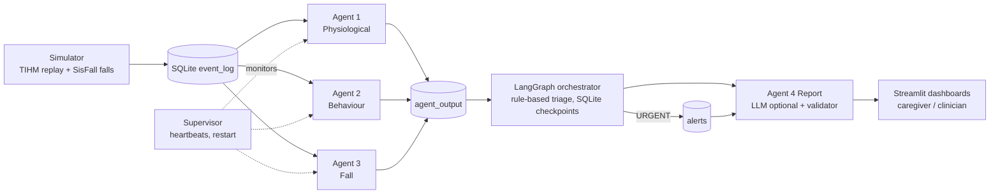

# ECHOS: Evidence-Centred Health Observation and Support through Collaborative AI Agents

Multi-agent decision support for home-dwelling elderly patients. **Not a diagnostic tool.** Results, tables and limitations are in [reports/RESULTS.md](reports/RESULTS.md).

## Overview

A simulator replays TIHM activity and physiology day by day and injects SisFall fall windows. Three analysis agents score each patient-day; a LangGraph orchestrator applies plain if-then triage (Normal / Monitor / Urgent, no trained fusion model) and a Report agent writes a daily caregiver report and a weekly clinician report. A supervisor watches SQLite heartbeats and restarts dead or stalled agents.

| Agent | What it does | Data |
|---|---|---|
| 1 Physiological | XGBoost on BP / heart-rate vs personal past-only baseline | TIHM Physiology + Labels |
| 2 Behaviour | Routine drift (z-score, CUSUM) + agitation classifier | TIHM Activity |
| 3 Fall | Random-forest on 2.5 s accelerometer windows + post-fall inactivity | SisFall only (TIHM has no falls) |
| 4 Report | Daily and weekly reports; optional Gemini wording, non-LLM validator, Jinja2 template fallback | agent outputs in SQLite |

Every agent returns the `AgentResult` schema ([echos/schemas.py](echos/schemas.py)). The LLM never decides emergencies; rules do. With no key or no `llm.model`, reports run in template mode.



## Setup

```bash
pip install -r requirements.txt
```

Place TIHM CSVs in `data/tihm/Dataset/` and SisFall in `data/sisfall/SisFall_dataset/` (data and models are git-ignored). Settings are in [config.yaml](config.yaml). Optional LLM: set `llm.model` in `config.yaml` and put `ECHOS_LLM_API_KEY` in `.env`.

## Run each stage

All commands from the repo root.

```bash
# 1. patient-day table
PYTHONPATH=. python3 -m echos.data.patient_day
# 2. train + evaluate agents (writes models/ and reports/metrics/agent{1,2,3}.json)
PYTHONPATH=. python3 -m echos.agents.physiological
PYTHONPATH=. python3 -m echos.agents.behaviour
PYTHONPATH=. python3 -m echos.agents.fall
# 3. triage thresholds from out-of-fold results (fall URGENT points; MONITOR alert budgets + OOF scores for e2e)
PYTHONPATH=. python3 scripts/choose_thresholds.py
PYTHONPATH=. python3 scripts/choose_monitor_thresholds.py
# 4. demo pipeline: replay -> agents -> orchestrator -> reports into data/echos.db
PYTHONPATH=. python3 scripts/run_demo.py 4 28
# 5. systems tests
PYTHONPATH=. python3 scripts/e2e.py 20             # 20 patients, full period -> reports/metrics/e2e.json
PYTHONPATH=. python3 scripts/fault_injection.py    # kill each agent, delay LLM, remove key -> fault_injection.json
PYTHONPATH=. python3 scripts/kill_test.py fall     # single kill test -> kill_test.json
# 6. merge metrics into one table (reports/results_table.md and .csv)
PYTHONPATH=. python3 scripts/evaluate.py
# tests
python3 -m pytest -q
```

## Dashboard

After step 4 (or any run that fills `data/echos.db`):

```bash
streamlit run echos/dashboard/app.py
```

The sidebar switches between the Caregiver page (daily report) and the Clinician page (weekly report). The dashboard reads only SQLite and `reports/`.

## Headline results (see RESULTS.md for CIs and caveats)

- Agent 1 PR-AUC 0.68 vs 0.26 for the fixed BP rule (out-of-fold, patient-level).
- Agent 2 PR-AUC 0.19 vs 0.05 base rate (within-patient ROC-AUC 0.81); drift alone is at chance and is report evidence only, not a Monitor trigger; the signal is mostly raw same-day activity.
- Agent 3 sensitivity 0.985 adults / 0.853 elderly (one subject), on SisFall scripted falls.
- End-to-end (20 patients, 60 injected falls): 57 detected (95%); days are 66% Normal / 29% Monitor / 6% Urgent with MONITOR thresholds chosen from out-of-fold alert budgets (<=1 vitals alert/patient-week, <=10% behaviour Monitor days, agitation_prob only) and out-of-fold agent scores.
- Fault injection: 0 lost, 0 duplicate alerts across all five scenarios.

Small cohort, clinical-alert labels, simulated falls: treat all numbers as preliminary.
