# ECHOS: Evidence-Centred Health Observation and Support through Collaborative AI Agents

Multi-agent decision support for home-dwelling elderly patients. **Not a diagnostic tool.** Results, tables and limitations are in [reports/RESULTS.md](reports/RESULTS.md).

## Overview

A simulator replays TIHM activity and physiology day by day and injects SisFall fall windows. Agent 0 (rule-based data quality) cleans each patient-day, then three analysis agents score it; a LangGraph orchestrator applies plain if-then triage (Normal / Monitor / Urgent, no trained fusion model) and a Report agent writes a daily caregiver report and a weekly clinician report. A supervisor watches SQLite heartbeats and restarts dead or stalled agents.

| Agent | What it does | Data |
|---|---|---|
| 0 Data quality | Rules only: range checks, duplicates/order, activity sensor-gap detection, completeness; never imputes. See [docs/DATA_POLICY.md](docs/DATA_POLICY.md) | TIHM Activity + Physiology |
| 1 Physiological | XGBoost on BP / heart-rate vs personal past-only baseline | TIHM Physiology + Labels |
| 2 Behaviour | Routine drift (z-score, CUSUM) + agitation classifier | TIHM Activity |
| 3 Fall | Random-forest on 2.5 s accelerometer windows + post-fall inactivity | SisFall only (TIHM has no falls) |
| 4 Report | Daily and weekly reports; guideline retrieval (RAG), optional Gemini wording, non-LLM validator, Jinja2 template fallback | agent outputs in SQLite |

Architecture details: [docs/ARCHITECTURE.md](docs/ARCHITECTURE.md). Every agent returns the `AgentResult` schema ([echos/schemas.py](echos/schemas.py)). The LLM never decides emergencies; rules do. With no key or no `llm.model`, reports run in template mode.

```mermaid
flowchart LR
    SIM["Simulator<br/>TIHM replay + SisFall falls"] --> EL[(SQLite event_log)]
    EL --> A0["Agent 0<br/>Data quality (rules)"]
    EL --> A3["Agent 3<br/>Fall"]
    A0 -->|cleaned patient-day| A1["Agent 1<br/>Physiological"]
    A0 --> A2["Agent 2<br/>Behaviour"]
    A0 --> AO
    A1 --> AO[(agent_output)]
    A2 --> AO
    A3 --> AO
    AO --> ORCH["LangGraph orchestrator<br/>rule-based triage, SQLite checkpoints<br/>DATA_GAP rule"]
    ORCH -->|URGENT| AL[(alerts)]
    ORCH --> A4["Agent 4 Report<br/>template + optional LLM + validator"]
    AL --> A4
    KB[("Guideline PDFs<br/>echos/knowledge/raw")] -->|ingest: clean, chunk, MiniLM embed| VS[("Chroma<br/>data/rag")]
    A4 -->|get_guideline: finding -> query| VS
    VS -->|top-k chunks KB-n| A4
    A4 -->|structured summary + KB chunks only| LLM["Gemini (optional)"]
    LLM -->|JSON: wording + cites| VAL["Validator (non-LLM)<br/>evidence ids, KB ids, paraphrase, no diagnosis"]
    VAL -->|ok| OUT
    VAL -->|rejected / timeout / no key| TPL["Jinja2 template fallback"]
    TPL --> OUT["Daily caregiver / weekly clinician report"]
    OUT --> DASH["Streamlit dashboards"]
    SUP["Supervisor<br/>heartbeats, restart"] -.monitors.-> A0
    SUP -.-> A1
    SUP -.-> A2
    SUP -.-> A3
```



## Setup

```bash
pip install -r requirements.txt
```

Place TIHM CSVs in `data/tihm/Dataset/` and SisFall in `data/sisfall/SisFall_dataset/` (data and models are git-ignored). Settings are in [config.yaml](config.yaml). Optional LLM: set `llm.model` in `config.yaml` and put `ECHOS_LLM_API_KEY` in `.env`.

## Report agent: LLM, RAG, privacy

- **LLM:** Google Gemini via `google-genai`; `config.yaml` currently has `llm.model: gemini-3.5-flash-lite`, temperature 0.2, timeout 45 s (never retried), 1 retry for other failures, 8 requests/min, backlog 200. No model or no key means template mode.
- **RAG (`rag.enabled`, default true):** guideline PDFs in `echos/knowledge/raw/` (CDC STEADI, NICE NG249 falls, NICE NG97 dementia, NICE NG136 hypertension, RCP NEWS2) are cleaned, split into ~250-word chunks (50-word overlap), embedded locally with `all-MiniLM-L6-v2` and stored in Chroma (`data/rag/`, git-ignored). Build with `PYTHONPATH=. python3 -m echos.knowledge.ingest`; check relevance with `scripts/rag_check.py`. The retriever (`get_guideline`) maps a finding type to a query and returns the top `k=3` chunks (cosine >= 0.25) with ids like `[KB-3]`. The LLM may only paraphrase them and must cite ids; the validator rejects uncited statements, unknown ids, near-verbatim copying and diagnostic wording. The template fallback and the weekly "References (for clinician review)" list the cited sources. `rag.enabled: false` removes guidance; reports still work.
- **Privacy:** the LLM receives only structured summaries (pseudonymous patient id, day, flags, statistics and evidence ids, plus retrieved public guideline text), never raw sensor rows, and never decides emergencies; alerts are written before any LLM call. Embeddings are computed locally. The API key is read from `.env` and never logged.

## Run each stage

All commands from the repo root.

```bash
# 1. patient-day table
PYTHONPATH=. python3 -m echos.data.patient_day
# 2. train + evaluate agents (writes models/ and reports/metrics/agent{1,2,3}.json)
PYTHONPATH=. python3 -m echos.agents.physiological
PYTHONPATH=. python3 -m echos.agents.behaviour
PYTHONPATH=. python3 -m echos.agents.fall
# 3. triage thresholds from out-of-fold results (fall URGENT points; MONITOR alert budgets + OOF scores for e2e)
PYTHONPATH=. python3 scripts/choose_thresholds.py
PYTHONPATH=. python3 scripts/choose_monitor_thresholds.py
# 4. demo pipeline: replay -> agents -> orchestrator -> reports into data/echos.db
PYTHONPATH=. python3 scripts/run_demo.py 4 28
# 5. systems tests
PYTHONPATH=. python3 scripts/e2e.py 20             # 20 patients, full period -> reports/metrics/e2e.json
PYTHONPATH=. python3 scripts/fault_injection.py    # kill each agent, delay LLM, remove key -> fault_injection.json
PYTHONPATH=. python3 scripts/kill_test.py fall     # single kill test -> kill_test.json
# 6. merge metrics into one table (reports/results_table.md and .csv)
PYTHONPATH=. python3 scripts/evaluate.py
# tests
python3 -m pytest -q
```

## Dashboard

After step 4 (or any run that fills `data/echos.db`):

```bash
streamlit run echos/dashboard/app.py
```

The sidebar switches between the Caregiver page (daily report) and the Clinician page (weekly report). The dashboard reads only SQLite and `reports/`.

## Headline results (see RESULTS.md for CIs and caveats)

- Agent 1 PR-AUC 0.68 vs 0.26 for the fixed BP rule (out-of-fold, patient-level).
- Agent 2 PR-AUC 0.19 vs 0.05 base rate (within-patient ROC-AUC 0.81); drift alone is at chance and is report evidence only, not a Monitor trigger; the signal is mostly raw same-day activity.
- Agent 3 sensitivity 0.985 adults / 0.853 elderly (one subject), on SisFall scripted falls.
- End-to-end (20 patients, 60 injected falls): 57 detected (95%); days are 66% Normal / 29% Monitor / 6% Urgent with MONITOR thresholds chosen from out-of-fold alert budgets (<=1 vitals alert/patient-week, <=10% behaviour Monitor days, agitation_prob only) and out-of-fold agent scores.
- Fault injection: 0 lost, 0 duplicate alerts across all five scenarios.

Small cohort, clinical-alert labels, simulated falls: treat all numbers as preliminary.
