# ECHOS architecture

Decision support, not diagnosis. Triage is plain if-then rules; the LLM only words reports.

```mermaid
flowchart LR
    SIM["Simulator<br/>TIHM replay + SisFall falls"] --> EL[(SQLite event_log)]
    EL --> A0["Agent 0<br/>Data quality (rules)"]
    EL --> A3["Agent 3<br/>Fall"]
    A0 -->|cleaned patient-day| A1["Agent 1<br/>Physiological"]
    A0 --> A2["Agent 2<br/>Behaviour"]
    A0 --> AO
    A1 --> AO[(agent_output)]
    A2 --> AO
    A3 --> AO
    AO --> ORCH["LangGraph orchestrator<br/>rule-based triage, SQLite checkpoints<br/>DATA_GAP rule"]
    ORCH -->|URGENT| AL[(alerts)]
    ORCH --> A4["Agent 4 Report<br/>template + optional LLM + validator"]
    AL --> A4
    KB[("Guideline PDFs<br/>echos/knowledge/raw")] -->|ingest: clean, chunk, MiniLM embed| VS[("Chroma<br/>data/rag")]
    A4 -->|get_guideline: finding -> query| VS
    VS -->|top-k chunks KB-n| A4
    A4 -->|structured summary + KB chunks only| LLM["Gemini (optional)"]
    LLM -->|JSON: wording + cites| VAL["Validator (non-LLM)<br/>evidence ids, KB ids, paraphrase, no diagnosis"]
    VAL -->|ok| OUT
    VAL -->|rejected / timeout / no key| TPL["Jinja2 template fallback"]
    TPL --> OUT["Daily caregiver / weekly clinician report"]
    OUT --> DASH["Streamlit dashboards"]
    SUP["Supervisor<br/>heartbeats, restart"] -.monitors.-> A0
    SUP -.-> A1
    SUP -.-> A2
    SUP -.-> A3
```

## Components

- **Simulator:** replays TIHM day by day into SQLite `event_log` and injects SisFall fall windows (TIHM has no falls).
- **Agent 0 (data quality, rules):** schema/type checks, duplicate and order handling, per-device range checks (implausible value -> NaN, listed, never imputed), activity SENSOR_GAP (zero events or < 5% of the patient's past median), completeness score. On error it passes data through with `quality_checked = False`; triage then treats the day as DATA_GAP. Details: [DATA_POLICY.md](DATA_POLICY.md).
- **Agents 1-3:** physiological (XGBoost vs past-only baseline), behaviour (drift + agitation classifier; only `agitation_prob` triggers Monitor), fall (random forest on SisFall + post-fall inactivity). Agents 1-2 wait for Agent 0's output of the same event unless its heartbeat is stale.
- **Orchestrator:** LangGraph, SQLite checkpoints, rules give Normal / Changed-monitor / Urgent. DATA_GAP can raise Normal to Monitor, never lower Urgent.
- **Agent 4 (report):** daily caregiver and weekly clinician reports. Template is always built first; optional Gemini wording is produced in a background worker and replaces it only if the validator passes.
- **Supervisor:** SQLite heartbeats, restarts dead or stalled agents.

## RAG flow (Report agent)

1. *Ingest* (`echos/knowledge/ingest.py`): read PDF/HTML/txt from `echos/knowledge/raw/`, drop page numbers and repeated headers, split into ~250-word chunks with 50-word overlap, skip reference lists/tables, embed with local `all-MiniLM-L6-v2`, store in Chroma at `data/rag/` with doc id, title, source name and pages. Chunk ids are stable (`KB-1`...).
2. *Retrieve* (`echos/knowledge/retrieve.py`): `get_guideline(finding_type, details, k=3)` builds a natural-language query from the structured finding (fall, fall with inactivity, blood pressure, NEWS2-type vitals, agitation, routine change), returns chunks above cosine 0.25 and logs each retrieval to `data/rag/retrieval_log.jsonl`. Data gaps get no guidance.
3. *Write:* the LLM sees only the structured summary plus the retrieved chunks; it must paraphrase and cite KB ids.
4. *Validate* (`echos/reports/validator.py`, no LLM): cited ids must be in the retrieved set, every guidance statement needs a citation, no run of 10+ copied words, no diagnostic wording; failure retries once, then falls back to the template, which prints the cited source names and page.
5. *Output:* weekly report adds "References (for clinician review)". `rag.enabled: false` or a missing index returns no chunks and reports continue unchanged.

## Privacy

Only structured summaries (pseudonymous patient id, day, status flags, aggregate statistics, evidence ids) and public guideline text leave the machine, and only when an LLM model and key are configured. Raw activity/physiology rows are never sent; embeddings run locally; the key lives in `.env`.
