# ECHOS architecture

Decision support, not diagnosis. Triage is plain if-then rules; the LLM only words reports and never decides an emergency. The diagram shows the current design.

```mermaid
flowchart LR
    SIM["Simulator<br/>TIHM replay + injected SisFall falls<br/>(synthetic: tests and demos only)"] --> EL[(SQLite event_log)]
    EL --> DQ["Data Quality agent<br/>(rules)"]
    EL --> FALL["Fall agent<br/>(SisFall-trained, independent)"]
    DQ -->|cleaned patient-day| HM["Health Monitoring agent<br/>vitals sub-model + behaviour sub-model<br/>(kept separate; SHAP, personal baseline, persistence)"]
    DQ --> AO[(agent_output)]
    HM --> AO
    FALL --> AO
    AO --> ORCH["LangGraph orchestrator (checkpointed)<br/>deterministic triage: Normal / Changed-monitor / Urgent<br/>safety rules: DATA_GAP never Normal, critical vitals, fall"]
    ORCH -->|immediate_alert node, BEFORE any report work| OB[(outbox)]
    OB --> DISP["Alert dispatcher<br/>retrying outbox, worker threads,<br/>2 h sweeper, dedup, fixed template, no LLM"]
    DISP --> MAIL["Caregiver + clinician e-mail<br/>(dry run by default)"]
    ORCH --> REP["Report agent<br/>context in prompt; tools: get_last_7_days, retrieve_guidance<br/>NORMAL days = template (gate)"]
    REP -->|MONITOR / URGENT findings only| RAG["Per-finding gated RAG<br/>local guideline index, then live PubMed"]
    RAG --> REP
    REP --> BUD["LLM budget manager<br/>cache, primary, fallback model, template"]
    BUD --> VAL["Non-LLM validator<br/>numbers, citation ids, no diagnosis / medication advice"]
    VAL -->|rejected, timeout, no key| TPL["Template report"]
    VAL -->|ok| OUT["Daily report (dashboard)<br/>Weekly clinician PDF (e-mail)"]
    TPL --> OUT
    OUT --> API["FastAPI<br/>reads SQLite + saved reports, no models"]
    API --> WEB["React web app"]
    SUP["Supervisor<br/>heartbeats, restarts"] -.-> DQ
    SUP -.-> HM
    SUP -.-> FALL
```

## Components

- **Simulator** (`echos/sim`): replays TIHM day by day into SQLite `event_log` and injects SisFall fall windows (TIHM has no falls and no accelerometer). Synthetic: tests and demos only.
- **Data Quality agent** (rules, `echos/agents/data_quality.py`): schema/type checks, duplicate and order handling, per-device range checks (implausible value -> NaN, listed, never imputed), activity sensor gap, completeness. On error it passes data through with `quality_checked = False` and triage treats the day as DATA_GAP. Details: [DATA_POLICY.md](DATA_POLICY.md).
- **Health Monitoring agent** (`echos/agents/health_monitoring.py`): a vitals sub-model (XGBoost on deviation from the person's past-only baseline) and a behaviour sub-model (agitation classifier; drift/CUSUM is explanation only). The two stay separate and the result (`HealthResult`) carries SHAP features, the personal baseline and persistence evidence. If it fails, fixed vitals thresholds are used and the day is marked "monitoring degraded" (DATA_GAP, never Normal).
- **Fall agent** (`echos/agents/fall.py`): random forest on 2.5 s SisFall accelerometer windows plus post-fall inactivity; independent of the other two agents.
- **LangGraph orchestrator** (`echos/orchestrator`): SQLite checkpoints; deterministic triage gives Normal / Changed-monitor / Urgent. Safety rules: a day with a data gap can never be Normal, Urgent always wins, critical vitals and a confirmed fall are Urgent. There is no trained fusion model and no alert lifecycle (no acknowledgement or escalation).
- **Alert dispatcher** (`echos/alerts`): fall and critical-vitals alerts are queued by the orchestrator's `immediate_alert` node before any report work, as a fixed template built from structured data (de-identified id + age band; no LLM, no RAG, no PubMed). One outbox row per alert and recipient role; background workers send with retry (exponential backoff, 15-minute window), a sweeper retries FAILED rows every 5 minutes for 2 hours; state lives in the database so it survives a restart. Dedup per fall event, and a per-patient cooldown for critical vitals. Real e-mail is off by default (`alerts.send_real: false` = dry run).
- **Report agent** (`echos/reports`): the daily report gets its patient context in the first prompt (with the patient id replaced by an alias), then a tool loop (`get_last_7_days`, `retrieve_guidance`; at most 3 tool steps) and a non-LLM validator; a validator failure gets one retry request without tools (worst case 5 requests, typical 1-2). NORMAL days get a template report (the gate: no LLM, no retrieval; it never changes triage or alerts). Weekly clinician report: PDF by e-mail, with findings mapped to sources and "Considerations for clinician review".
- **Per-finding gated RAG** (`echos/knowledge`, `echos/reports/retrieval.py`, `echos/reports/evidence.py`): only MONITOR / URGENT findings retrieve. Vitals findings are direction-aware (BP high, BP low, heart rate high / low, temperature, weight change, or a combination of readings), each with its own local query, PubMed terms and relevance terms; a source that does not match its finding is dropped (low blood pressure never cites hypertension guidance) and a finding with nothing relevant shows "no supporting source retrieved". Order: local index, then live PubMed (abstracts are used for matching and are not shown).
- **LLM budget manager** (`echos/reports/llm_budget.py`): cache -> primary model -> fallback model -> template; limiter below each model's per-minute limit; a 429 is a 60 s cooldown (no retry); timeouts are never retried. The LLM is optional: template mode needs no key.
- **Validator** (`echos/reports/validator.py`, no LLM): every number comes from the data, every citation id was retrieved, no diagnostic wording, no medication advice, no agitation score. A rejected report falls back to the template. Weekly considerations must also name a concrete value, count or date.
- **Supervisor** (`echos/orchestrator/supervisor.py`): runs the three workers (quality, health_monitoring, fall), writes heartbeats to SQLite and restarts dead ones. It is a single point of failure for restarts only.
- **FastAPI** (`echos/api`): bound to 127.0.0.1, no authentication (demo), reads SQLite and saved reports and sends commands to the runtime through the `sim_command` table; it never loads models. Addresses are masked, secrets never returned. See [API.md](API.md).
- **React web app** (`web/`): Dashboard, Fall Monitor, Patient, Caregiver, Clinician, System, and a Demo guide drawer in demo mode.

## RAG flow

1. *Ingest* (`echos/knowledge/ingest.py`): read the guideline PDFs from `echos/knowledge/raw/` (listed in `echos/knowledge/SOURCES.md`), drop page numbers and repeated headers, split into ~250-word chunks with 50-word overlap, embed with local `all-MiniLM-L6-v2`, store in Chroma at `data/rag/`. Chunk ids are stable (`KB-1`...).
2. *Retrieve* (`echos/knowledge/retrieve.py`, `relevance.py`): the finding type maps to a query; chunks above the cosine cut-off come back with ids; the weekly report applies a stricter cut-off (`weekly.evidence.local_min_score`) and keeps at most 2 sources per finding (local first, at most 1 PubMed).
3. *Write:* the LLM (if enabled) sees only the structured summary plus the retrieved sources; it must paraphrase and cite ids.
4. *Validate:* see above; failure retries once, then the template is used.

## Privacy

Only structured summaries (pseudonymous patient id, day, status flags, aggregate statistics, evidence ids) and public guideline text leave the machine, and only when an LLM key is configured. Raw activity/physiology rows are never sent; embeddings run locally; keys live in `.env` (git-ignored). Alert e-mails carry a de-identified id and age band only.
