# ECHOS architecture

**What ECHOS is for.** It watches the sensors and vital signs of one older person at home and tells their caregiver and clinician (a) at once when a fall or a critical reading is detected and (b) once a day whether anything differs from that person's own usual, with the evidence. Decision support, not diagnosis: triage is plain if-then rules, and the LLM only words reports and never decides an emergency.

**Who uses it.** Caregiver: *Is the person OK today, do I need to act now?* (Today, Alerts). Clinician: *Who changed this week and on what evidence?* (Clinician week, case files). Operator / examiner: *Is the system healthy and is the data live or simulated?* (How it works, System).

**Three data modes, always labelled in the UI** (`GET /api/live/status`, the badge in the header): **REPLAY** (TIHM replayed day by day, for evaluation), **EMULATOR** (a labelled device emulator replays real TIHM raw events in wall-clock time; falls injected from SisFall) and **LIVE** (real devices call the ingestion API). Replay and live use the same triage rules, alert path, agents and reports.

```mermaid
flowchart LR
    SRC["Sources<br/>replay (TIHM days) | emulator (wall-clock) | real device"] -->|POST /api/ingest/events| EV[(event_log)]
    EV --> Q["Quality gate (detector)"]
    EV --> V["Vitals detector"]
    EV --> F["Fall detector"]
    Q --> T
    V --> T
    F --> T
    T["Triage agent<br/>if-then rules: Normal / Changed-monitor / Urgent<br/>rolling in live mode (provisional until the day closes)"]
    T -->|URGENT: BEFORE any other work| OB[(outbox)]
    OB --> D["Alert dispatcher<br/>retries, dedup, fixed template, no LLM"]
    D --> MAIL["caregiver + clinician e-mail (dry run by default)"]
    T -->|case_opened| INV["Case Investigator agent<br/>bounded tool loop -> case file + trace"]
    INV -->|case_file_ready| COORD["Care Coordinator agent<br/>ack deadline, escalation, check-in and review tasks"]
    INV -->|case_file_ready| REP["Report agent<br/>LLM optional + non-LLM validator"]
    D -.->|delivered| COORD
    COORD -->|no ack in time| MAIL2["second contact (escalation)"]
    REP --> OUT["daily report | weekly clinician PDF"]
    OUT --> API["FastAPI (reads SQLite, never loads models)"]
    COORD --> API
    INV --> API
    API --> WEB["React web app: Today, Alerts, People, How it works ..."]
    SUP["Supervisor<br/>(replay: 3 detector worker processes)"] -.-> Q
    SUP -.-> V
    SUP -.-> F
```

## Components

Full list with inputs, outputs, failure behaviour and what each must never do: [COMPONENTS.md](COMPONENTS.md) (generated from `echos/components.py`, also served by `GET /api/components` and shown on the *How it works* page).

- **Detectors** (sense, never decide): Data Quality gate (`echos/agents/data_quality.py`), Vitals detector (`echos/agents/health_monitoring.py`, `echos/agents/health/`), Fall detector (`echos/agents/fall.py`, SisFall only, independent of the others).
- **Agents** (goal, tools, action, trace): Triage (`echos/orchestrator`, a sequential pipeline in replay; `echos/live/processor.py` in live mode; both call the same pure `triage()`; why its rules are justified: `docs/TRIAGE_ALGORITHM.md`), Case Investigator (`echos/team/investigator.py`), Care Coordinator (`echos/team/coordinator.py`, `lifecycle.py`), Report agent (`echos/reports`).
- **Team Planner** (`echos/team/planner.py`, infra, not a fifth agent): right after Triage, one ratio r = max_k p_k / tau_k (detector score over its own alert threshold) and one budget-chosen cutoff theta decide which of the four agents the case needs (Normal = Triage + template report; Normal near miss, r > theta = + a short watch file from the Investigator; changed = + Investigator and a passive hand-over to the Coordinator; urgent = Coordinator owns the alert) and record a reason per agent on the bus (`team_plan`, `GET /api/patients/{id}/team-plan`). It never changes a status or delays an alert. Why four agents, and what the planner saves on replayed days: `docs/TEAM_DESIGN.md` (`scripts/tuning/team_design.py`).
- **Infrastructure:** Supervisor (replay), alert dispatcher (`echos/alerts`), message bus (`echos/team/bus.py`), ingestion + live store (`echos/live`), SQLite state (`echos/orchestrator/state.py`).

### Live path (`echos/live`)
`POST /api/ingest/events` (schema `echos/live/schemas.py`, idempotent) -> `event_log` kinds activity / vitals / accel / heartbeat -> `LiveProcessor`: builds the patient-day row from the raw events (`features.py`, same columns and rules as the training table), scores the detectors from it (the training table only supplies the person's earlier history), runs the same triage, queues the URGENT alert at once, runs the Case Investigator on a changed decision and writes the report at day close. A day is PROVISIONAL until an event of a later day arrives. `scripts/evaluation/live_parity.py` checks the scores equal the replay path's.

### Alert lifecycle (`echos/team`)
NEW -> SENT -> ACKNOWLEDGED -> RESOLVED, or ESCALATED when nobody acknowledged by the deadline (fall 300 s, critical vitals 1800 s, wall clock), or EXPIRED when it is too old to act on. The Care Coordinator runs in its own thread, keeps all state in SQLite and survives a restart; the dispatcher sends the first alert and never waits for it.

## RAG flow

1. *Ingest* (`echos/knowledge/ingest.py`): read the guideline PDFs from `echos/knowledge/raw/` (listed in `echos/knowledge/SOURCES.md`), drop page numbers and repeated headers, split into ~250-word chunks with 50-word overlap, embed with local `all-MiniLM-L6-v2`, store in Chroma at `data/rag/`. Chunk ids are stable (`KB-1`...).
2. *Retrieve* (`echos/knowledge/retrieve.py`, `relevance.py`): the finding type maps to a query; chunks above the cosine cut-off come back with ids; the weekly report applies a stricter cut-off (`weekly.evidence.local_min_score`) and keeps at most 2 sources per finding (local first, at most 1 PubMed).
3. *Write:* the LLM (if enabled) sees only the structured summary plus the retrieved sources; it must paraphrase and cite ids.
4. *Validate:* see above; failure retries once, then the template is used.

## Privacy

Only structured summaries (pseudonymous patient id, day, status flags, aggregate statistics, evidence ids) and public guideline text leave the machine, and only when an LLM key is configured. Raw activity/physiology rows are never sent; embeddings run locally; keys live in `.env` (git-ignored). Alert e-mails carry a de-identified id and age band only.
